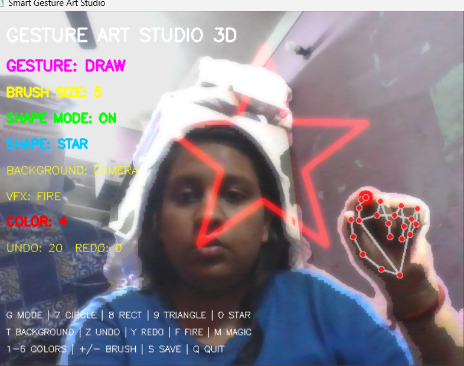
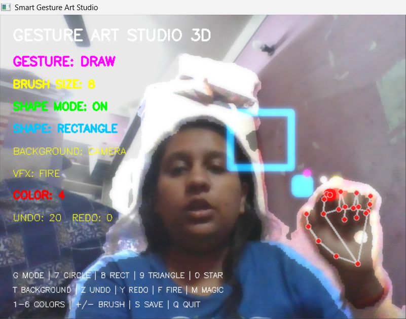
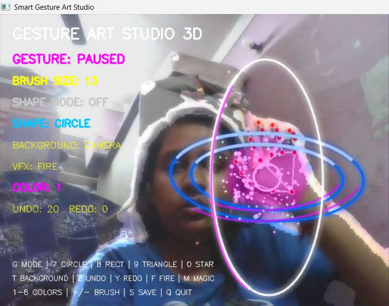

# 🎨 Gesture Art Studio 3D

### ✋ Your Hand. Your Imagination. Your Digital Canvas.

**A Real-Time AI-Powered Air Drawing Application Using Hand Gestures, Computer Vision & Visual Effects.**

<p align="center">
  
  
  
  
</p>

<p align="center">
  <a href="https://github.com/riyagarg3729/Gesture-Art-Studio">GitHub Repository</a> •
  <a href="#-screenshots">Screenshots</a> •
  <a href="#-installation">Installation</a>
</p>

---

## 🚀 About The Project

**Gesture Art Studio 3D** is an interactive computer vision project that transforms your webcam into a touchless digital drawing studio.

It allows users to draw in the air, create geometric shapes, change brush sizes, erase drawings and activate stunning visual effects using natural hand gestures.

Powered by Python, OpenCV and MediaPipe, the application detects hand landmarks in real time and translates hand movements into interactive digital artwork.

**No mouse. No drawing tablet. Just your hand and imagination!**

---

## 📸 Screenshots

These are real screenshots captured from the running Gesture Art Studio application.

### 1. Real-Time Hand Tracking & Fire Effect

## 📸 Screenshots

<p align="center">
  
  
</p>

<p align="center">
  
  
</p>

---

## ✨ Key Features

| Feature | Description |
|---|---|
| ✋ Hand Tracking | Real-time hand landmark detection |
| 🎨 Air Drawing | Draw using your index finger |
| 🖌️ Dynamic Brush | Change brush size dynamically |
| 🌈 Color Palette | Multiple drawing colors |
| 🧽 Gesture Eraser | Erase using pinch gesture |
| ↩️ Undo & Redo | Undo and restore drawing actions |
| 📐 Shape Drawing | Circle, rectangle, triangle and star |
| 🔥 Fire Effect | Animated fire particles |
| ✨ Magic Burst | Energy rings, sparks and shockwaves |
| 💨 Smoke Effect | Particle-based smoke |
| 🌈 Rainbow Effect | Colorful visual effects |
| 💜 Neon Trails | Glowing trails following hand movement |
| 🎭 Background Modes | Multiple customizable backgrounds |
| 🪄 Background Removal | Person segmentation using MediaPipe |
| 💾 Save Artwork | Export artwork as PNG |

---

## 🖐️ Gesture Recognition

Control the drawing application using hand gestures.

| Hand Gesture | Action |
|---|---|
| ☝️ Index Finger | Draw |
| ✌️ Peace Sign | Stop Drawing |
| 🖐️ Open Palm | Pause |
| 🤟 Three Fingers | Magic Burst |
| ✊ Fist | Clear Canvas |
| 🤏 Pinch | Eraser |
| 👍 Thumb | Previous Color |
| 🖐️ Four Fingers | Next Color |

---

## 🎆 Visual Effects Engine

The VFX engine adds interactive visual effects to hand movements and drawing actions.

- 🔥 Fire Particle Effects
- ✨ Magic Burst Explosions
- 💨 Smoke Particles
- 🌈 Rainbow Effects
- 💜 Neon Light Trails
- ⚡ Rotating Energy Rings
- 🌟 Glowing Particles and Sparks
- 💥 Shockwave Effects

---

## ⌨️ Keyboard Shortcuts

| Key | Action |
|---|---|
| `1–6` | Change Drawing Color |
| `+ / -` | Increase / Decrease Brush Size |
| `G` | Toggle Shape Mode |
| `7` | Circle |
| `8` | Rectangle |
| `9` | Triangle |
| `0` | Star |
| `Z` | Undo |
| `Y` | Redo |
| `F` | Fire Effect |
| `M` | Magic Effect |
| `B` | Smoke Effect |
| `R` | Rainbow Effect |
| `E` | Turn VFX Off |
| `T` | Change Background |
| `S` | Save Artwork |
| `Q` | Quit Application |

---

## 🛠️ Technology Stack

<p align="center">
  
</p>

- **Python 3.12** – Core programming language
- **OpenCV** – Real-time image processing and webcam access
- **MediaPipe** – Hand tracking, gesture recognition and person segmentation
- **NumPy** – Numerical computing and image operations
- **Pygame** – Supporting graphics functionality

---

## 🏗️ Project Architecture

```text
Gesture-Art-Studio/
│
├── assets/
│   └── screenshots/
│       ├── 01-hand-tracking-fire.png
│       ├── 02-magic-energy-rings.png
│       ├── 03-rectangle-drawing.png
│       └── 04-star-shape-drawing.png
│
├── src/
│   ├── core/
│   │
│   ├── effects/
│   │   ├── background_engine.py
│   │   ├── particle_engine.py
│   │   ├── segmentation_engine.py
│   │   ├── shape_engine.py
│   │   └── vfx_engine.py
│   │
│   ├── gestures/
│   │   ├── air_drawing.py
│   │   ├── gesture_recognition.py
│   │   └── smart_air_drawing.py
│   │
│   └── hand_tracker.py
│
├── main.py
├── requirements.txt
├── .gitignore
└── README.md
```

---

## 💻 Installation

### Prerequisites

- Python 3.12
- Webcam
- Windows recommended
- Good lighting for accurate hand tracking

### Step 1: Clone Repository

```bash
git clone https://github.com/riyagarg3729/Gesture-Art-Studio.git

cd Gesture-Art-Studio
```

### Step 2: Create Virtual Environment

```bash
python -m venv .venv312
```

### Step 3: Activate Environment (Windows)

```powershell
.venv312\Scripts\activate
```

### Step 4: Install Dependencies

```bash
pip install -r requirements.txt
```

### Step 5: Run Application

```bash
python src/gestures/smart_air_drawing.py
```

Allow webcam access and start creating digital artwork using hand gestures!

---

## 🧠 What I Learned

Building this project helped me explore and practice:

- Real-time computer vision
- Hand landmark detection
- Gesture recognition
- Image processing using OpenCV
- Particle animation systems
- Real-time webcam integration
- Modular Python architecture
- Visual effects development
- Background segmentation

---

## 🔮 Future Enhancements

- Advanced 3D holographic visual effects
- Two-hand gesture interaction
- More drawing tools and animations
- Improved background segmentation
- Performance and FPS optimization
- Interactive virtual art experience

---

## 👩‍💻 Developer

### Riya Garg

Computer Engineering Student | Python | AI/ML | Computer Vision

<p align="center">
  <a href="https://github.com/riyagarg3729">
    
  </a>
</p>

---

## ⭐ Support

If you find this project interesting, please consider giving it a ⭐ on GitHub.

<p align="center">
  <b>Made with ❤️, Python and Computer Vision.</b>
</p>